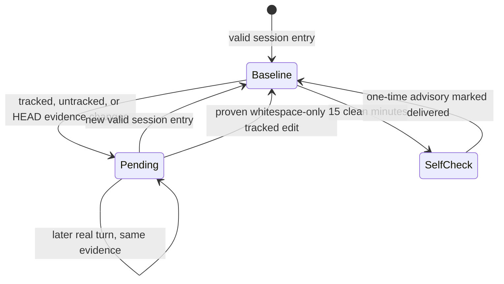

---
tags:
  - session-log-diagrams
diagram_date: 2026-09-28
---

## 2026-09-28 17:13 - Evidence-backed session record checkpoint lifecycle

```yaml
adr_id: adr_session_log_trigger_enforcement
grounded_in:
  - mse_dpa5g3h1fma6dazw:d1
  - mse_gef34nw8hafgv3nf:d1
```


