# Memory Seed - Functionality Audit

> **Current reconciliation — 2026-10-19.** This revision supersedes the audit's former July/August
> current-state claims. It covers the released local OSS surface through `2.24.0` and the separately
> scoped hosted team-edition programme. Historical roadmap material remains in Appendix A for
> provenance only.

**As of:** 2026-10-19 — control plane `2.24`; checkout package and latest published package `2.24.0`.

**Scope:** current local OSS and hosted-edition functionality, subsystem relationships, data flows,
verification surfaces, known debt, and the active roadmap. Source/config files remain implementation
truth; the roadmap describes sequenced intent rather than shipped behaviour.

### Audit provenance

- The 2026-07-13 audit established the original CLI, MCP, lifecycle-link, integration-mode, DRAFT-format,
  Memory Trace, and verification inventory.
- The 2026-07-16 reconciliation made Wave 1 the then-current baseline and moved earlier roadmap material
  into the historical appendix.
- Later focused updates added worktree reconciliation, session checkpoints, automatic lifecycle-link
  classification, Reflection Board retirement, and selected `2.23.0` capabilities, but left the document's
  header, roadmap, edition boundary, CLI/MCP inventory, and test counts stale. This reconciliation closes
  those gaps without rewriting the historical appendix.

---

## 1. What Memory Seed is

Memory Seed is the model-independent memory substrate for preserving project decisions, evidence, and
reasoning across humans and AI agents. It now has an explicit edition boundary:

- The **OSS/local edition** is portable, local-first, Markdown-authoritative, and distributed as the
  `memory-seed` Python package. It needs no server, database, account, or network. Durable memory lives in
  Markdown + YAML under the nearest `.memory-seed/` runtime. The CLI maintains the control plane, the
  optional stdio MCP server exposes retrieval and guarded workflow tools, and Memory Trace provides a local
  read-only review UI.
- The **hosted team edition** is a separate service programme under `hosted/`. Its target authority is SQL
  with complete human-readable Markdown export. It never silently converts a local repository into a
  synchronized replica, and it is excluded from the published OSS package. Through R1-R5 of the current
  transfer plan, Markdown remains authoritative; SQL authority begins only at the human-gated R6 cutover.

Both editions share semantic contracts where useful, but they do not share writable persistence authority.
The local routing model remains vendor-neutral: one canonical `AGENTS.md`, thin per-agent routing files, and
merged hook/MCP configuration for Claude Code, Codex, Cursor, Gemini, and GitHub Copilot.

---

## 2. System map

At the highest level, each edition has exactly one authoritative substrate. The local edition interprets
human-verifiable Markdown sessions, sidecars, and ADRs as the canonical memory graph. Memory Trace, CLI,
MCP, Graphify, caches, and indexes are derived views over those files. The hosted edition's target substrate
is PostgreSQL; Markdown is a complete export rather than a second writer. Transfers between editions are
explicit, staged, and receipt-backed.

### Conceptual architecture

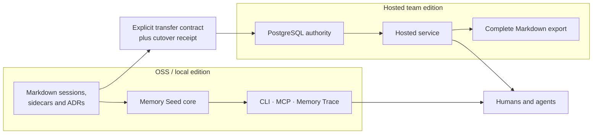

### Implementation map

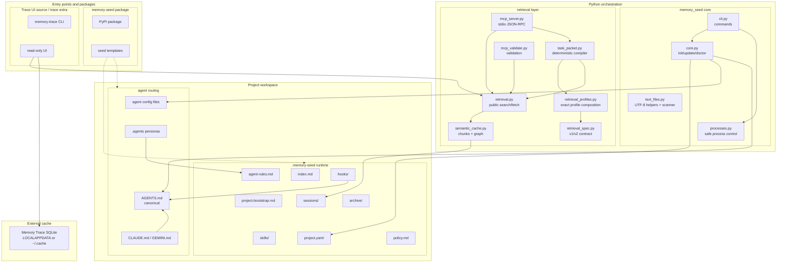
## 3. Feature inventory (current)

Unless a bullet explicitly says **Unreleased** or **Planned**, this section describes behaviour present in
the `2.24.0` checkout. Versioned historical qualifiers are retained only where they explain when a contract
entered the product; they are not release-status labels.

### A. Distribution & packaging
- Python package `memory-seed` (`pyproject.toml`, setuptools), Python >= 3.11, published to PyPI via GitHub Release -> `.github/workflows/publish.yml` with an OIDC **manual-approval `pypi` gate**.
- **Verification gates.** `.github/workflows/verify.yml` runs on pushes to `main`, pull requests, and reusable-workflow calls: the full root `pytest tests` suite, repository `links check`, all Memory Trace tests, and the React `npm ci`/typecheck/build gate. The React build must leave `memory-trace/memory_trace/static/react/` unchanged, proving packaged assets are current; `publish.yml` calls the same workflow before packaging.
- Console entry points: `memory-seed` (CLI), `memory-seed-mcp` (MCP stdio server), `memory-seed-mcp-validate` (retrieval validation harness).
- Seed templates under `memory_seed/seed/` are the source of truth installed into projects; the repo dogfoods its own seed (live `.memory-seed/` must stay in sync with the seed twin - enforced by tests).
- **Download footprint:** the `memory-seed` artifact itself remains small and pure Python +
  Markdown/HTML/CSS/JS templates (no compiled extensions). A full install also resolves the required
  runtime dependency, `model2vec` (which pulls `numpy`), so the installed on-disk footprint is
  dominated by transitive deps, not Memory Seed's own code. The review UI source lives under
  `memory-trace/`, but its web stack (`fastapi`/`uvicorn`) is installed only through the optional
  `memory-seed[trace]` extra. Plain `pip install memory-seed` remains web-framework-free. The
  `memory-seed[lense]` deprecated alias was removed for the 2.20 release (Track A.4).
- **Lightweight install (2026-07-22).** `model2vec` stays a *required* dependency — semantic ranking
  is part of the product — but because it is the package's **only** required dependency,
  `pip install --no-deps memory-seed` is the supported install without it. Extras can only add
  dependencies, never subtract, so "memory-seed without semantic" cannot be expressed as an extra;
  the equivalence is pinned by `test_model2vec_is_the_only_required_dependency`, which fails the
  suite if a second required dependency is added rather than letting that path break silently.
  Everything except *ranking* still works: search falls back from semantic to lexical, `link audit`
  loses its strongest scoring signal, and `esr` reports the degraded state on every run.

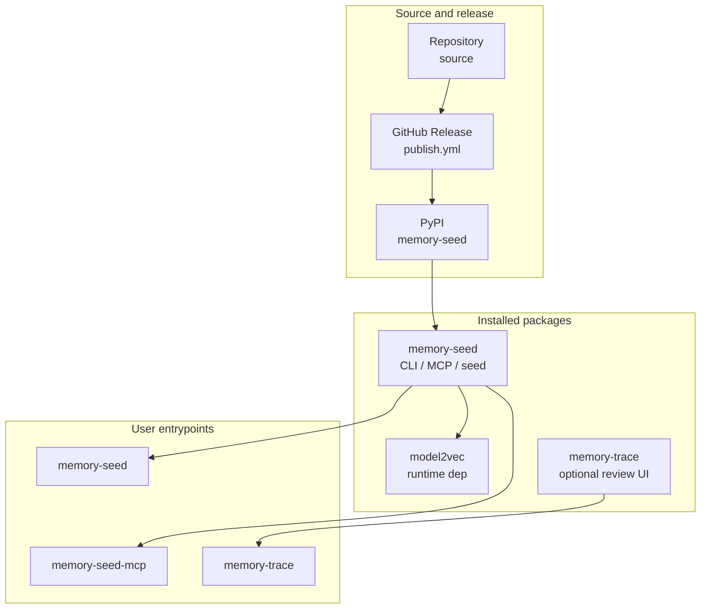

### B. CLI surface (`memory_seed/cli.py`)
| Command | Purpose |
|---|---|
| `init [--agents ...] [--no-agent-prompt] [--dry-run] [--force]` | Copy control plane + routing into a project; prompts on a TTY for opt-out agent integration selection unless skipped. |
| `update [--dry-run]` | Forward-only refresh of control-plane files; archives replaced versions; preserves generated/local memory. |
| `doctor` | Health check: missing files, version mismatches, bootstrap completeness, non-fatal warnings. |
| `retrieval-spec preview\|resolve --spec-file ...` | Validate or resolve inline/profile-aware Retrieval Specifications into deterministic Evidence Packs. |
| `task-packet preview\|compile\|render\|from-plan\|governance-load ...` | Compile deterministic Task Packets, render client-neutral worker prompts, derive task dispatches from approved plans, and load digest-pinned worker governance. |
| `discovery evidence\|assess ...` | Build a bounded Design Discovery authority pack, then require one source-bound verdict per governing clause, ADR, decision, or explicit pin. |
| `telemetry migrate\|summary\|health` | Inspect or additively migrate Git-common workflow telemetry that survives worktree cleanup. |
| `constitution topics [--topic ...]` | Show the derived topic-to-Constitution-clause map used by bounded evidence retrieval. |
| `compact [--days N] [--output]` | Summarise recent session activity; writes only with `--output`. |
| `agents list \| add <a> \| remove <a>` | Show selected/ignored agents or reconfigure installed agent integrations (cleanup-aware removal). |
| `user set <slug> \| show \| clear` | Manage the local active user in gitignored `.memory-seed/local.yaml` (new in 2.10). |
| `session target [--create] [--user <slug>] [--date ...]` | Print (and optionally create) the active grouped session-log target; flat or per-user depending on the resolved user and participant gate. |
| `session append\|reorder\|entry-id\|checkpoint ...` | Author guarded DRAFTS entries, repair same-day chronology, derive canonical IDs, and inspect or mechanically resolve session-record checkpoint debt. |
| `session fuse --branch <branch> [--base <ref>] [--apply]` | Dry-run or apply branch-local session entries/sidecars into the current integration tree; apply requires an in-progress merge and validates branch provenance, chronology, immutable existing entries, and sidecar parent entries. |
| `session merge-branch --branch <branch> [--dry-run]` | One-step branch integration: fuse dry-run gate, `git merge --no-ff --no-commit`, session-path reset, fuse apply, stage, commit, then cleanup of the exact clean registered source worktree when one exists. Git removal is primary; an already-deregistered directory is removed only after repository, branch, administrative-pointer, directory-identity, and path-type revalidation. Dirty, locked, still-registered, replaced, unreadable, or otherwise unproven paths are retained, and pending cleanup is an incomplete task outcome; branches are never deleted. Requires a clean integration working tree. |
| `session prepare-pr\|open-pr\|integrate --branch <branch>` | Run mode-aware integration: local merge/fuse under `local-merge`, or guarded push and pull-request preparation under `pr`; manual merge triggers require live approval. |
| `branch status [--json]` | Read-only: report current Git branch/worktree posture and warn when distinct feature work should move to a task branch with `--no-ff` integration. |
| `worktree guard\|status\|home ...` | Enforce agent namespace safety and manage the persistent per-agent home worktree, including claim, overflow, park, release, resume, and status. |
| `adr promote\|revise\|transition\|reviewed\|show\|list\|check ...` | Maintain append-only ADR ledgers and derived current heads without rewriting decision history. |
| `ranking-ab --signal <name> [--query <q> ...] [--json]` | Run a deterministic full-corpus ranking signal comparison off/on; require directional wins and unchanged no-affected-hit controls where defined; fail closed on missing evidence. |
| `links check\|chain\|graph-diff ...` | Validate session-memory integrity, inspect decision refinement chains, and snapshot/compare the effective lifecycle graph. |
| `topics list\|check\|suggest\|amend ...` | Inspect and validate the controlled vocabulary, suggest topics from evidence, or append a corrected decision-topic snapshot. |
| `migrate sessions-layout [--dry-run]` | Split legacy flat session files into grouped per-user files using `project.yaml` participants; preserves entry IDs, backs up before removing migrated sources. |
| `migrate sessions-month-layout [--dry-run]` | Explicitly move old flat/day session files and old diagram sidecars into `YYYY-MM/` folders with backups; never automatic. |
| `link suggest [--for <entry_id>] [--top-k N]` | Read-only: rank older candidate entries to link from a target entry; prints a paste-ready `related_entries:` snippet (new in 2.13). |
| `link show <entry_id>` | Read-only: print an entry's stored outbound `related_entries`, computed inbound backlinks, `supersedes`/`superseded_by`, `inbound_relation_count`, and `importance_score`. |
| `link commits <entry_id>` | Read-only: print commit links from the entry's `commits:` field plus commits carrying the `Memory-Entry:` trailer. |
| `link audit\|batch-plan\|batch-collect\|batch-finalize\|batch-apply\|batch-gc\|verify\|retract ...` | Discover lifecycle gaps, coordinate two-run classification, apply only mechanically valid agreement, optionally verify, and append retractions without editing history. |
| `docs check\|index` | Validate lifecycle lanes, pointers, metadata, and links; regenerate marker-scoped lane indexes. |
| `quality report` | Measure the current corpus quality surface while preserving unavailable/not-applicable states. |
| `provenance check\|show\|bind ...` | Inspect and append reference-only decision-to-Git provenance bindings. |
| `esr` / `situate` | Run end-of-turn health and session-start orientation reports from measured repository state. |
| `hooks status [--json]` | Read-only: report whether the `prepare-commit-msg` trailer hook is current, missing, stale, broken, or blocked by a foreign hook. |
| `hooks repair` | Install or refresh only missing or Memory Seed-managed trailer hooks; foreign hooks are reported and left untouched. |
| `processes [--json]` | Read-only: list active package-owned Memory Seed processes. |
| `shutdown [--dry-run] [--yes] [--json]` | Preview or stop only matching package-owned Memory Seed processes after confirmation; default answer is no. |
| `upgrade [--dry-run] [--yes] [--manager uv\|pipx\|pip] [--json]` | Handle active package-owned processes, then run the selected package-manager upgrade command; failed shutdown blocks upgrade. |
| `encoding check [path] [--json]` | Read-only: report invalid UTF-8, UTF-8 BOMs, CRLF line endings, non-NFC text, likely mojibake, and implicit text-mode Python I/O. |
| `encoding repair [path] [--dry-run] [--json]` | Preview or atomically repair safe BOM/newline/NFC drift after timestamped backup; block invalid UTF-8 and likely mojibake for manual review. |
| `version` | Print bundled control-plane version. |
| `help` (or no args) | Full command reference. |

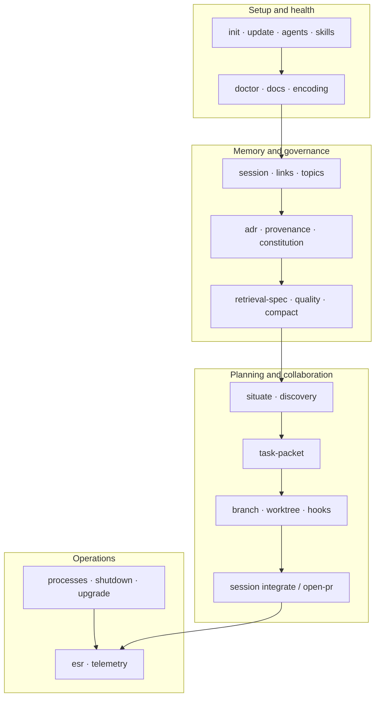

### C. Agent-selective install (`core.py`)
- `init` installs only the chosen agents' files; the set persists in `.memory-seed/project.yaml` (`agents:` list).
- Backed by registries: `KNOWN_AGENTS = (claude, codex, cursor, gemini, copilot)`, `_AGENT_MERGES`, `_AGENT_UNINSTALLS`, and a per-`SeedFile` `agent` tag.
- Interactive init presents agent integrations as an opt-out selection step with all agents selected by default; `--no-agent-prompt` skips that prompt, and `--agents none` writes the explicit zero-agent state.
- **Absent `project.yaml` => all agents** (legacy default unchanged); **present-but-empty `agents:` => zero agents** (distinct state). `doctor`/`update` respect the selection. Init and `agents list` report both selected and ignored agents. `remove` strips only Memory Seed's own entries (foreign config preserved), backs up first, never deletes shared dirs. `codex`/`cursor` get no routing file (they read `AGENTS.md` natively).

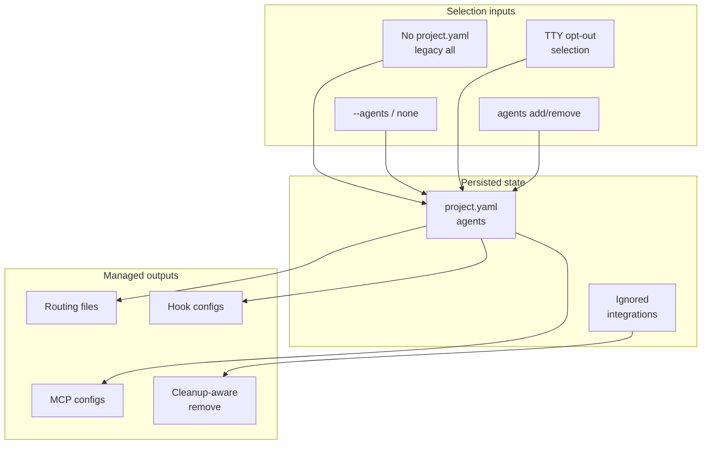

### D. Control-plane runtime (`.memory-seed/`)
- `agent-rules.md` (compact startup contract: discovery, read order, authority rules, change gates, **Working Principles**, **End Of Turn** pointers), `project-bootstrap.md` (bootstrap/repair only), `index.md` (orientation/active state/topology - bootstrap-generated), `policy.md` (constraints only - bootstrap-generated), `skills/`, `sessions/`, `archive/`, `hooks/`.
- Nearest-runtime discovery (`resolve_runtime`) supports nested sub-project runtimes; legacy `.AGENTS/` remains a code-level fallback.
- **Lazy-skill extraction (new in 2.13).** Detailed procedures that used to live directly in `agent-rules.md` were moved out into seeded skills - `history_retrieval.md`, `session_logging.md`, `end_of_turn.md`, `memory_hygiene.md`, `subproject_runtime.md` - so `agent-rules.md` now keeps startup-safe summaries plus explicit skill pointers, and seeded ESR commands point at `end_of_turn.md` for the full checklist.
- **Session-first worktree reconciliation (shipped in 2.22.0).** The core `worktree_reconciliation.md` skill
  starts each dirty, stale, detached, or deregistered cleanup review from the candidate's own measured
  Memory Seed orientation and branch-local session storyline, then uses Git to verify reachability,
  divergence, dirty content, duplication, registration, and removal safety. It requires one descriptive
  summary and explicit content classification per worktree, separate live approval for each exact
  deletion target, branch preservation by default, and post-removal registration/path verification.
- **Working Principles gained guard-preservation bullets (new in 2.14).** Follow-up to a fan-out evaluation of a third-party code-simplification plugin proposal (rejected as redundant with the built-in `code-review`/`simplify` skills and the existing orphan sweep): a decision-ladder-before-adding-code habit, and a reminder not to strip terse validation/ownership guards (a date-format check, an `is_ours` MCP-ownership check, an `isinstance` guard) without understanding what they protect against. Landed in Working Principles rather than a new skill file, since the risk applies to any incidental edit, not just tasks that self-identify as "code simplification." Backed by new regression tests for the two guards a codebase audit found genuinely untested (`_valid_session_date`; the `is_ours` check in the claude/cursor/gemini MCP-merge functions).
- **Mermaid usage guidance bullet (new in 2.14).** A third new Working Principles bullet: default to plain text; reserve Mermaid for genuinely spatial, temporal, or concurrent structure; keep blocks small; check syntax *and* semantic freshness (roadmap diagrams must be updated when shipped work changes status). From `docs/5_Completed/mermaid-usage-guidance-plan.md`. `session_logging.md`'s Reason Rules simultaneously gained the failed-approaches rule: an attempted-and-failed or incompatible approach must be logged under `A` even unprompted (`docs/5_Completed/failed-approaches-logging-plan.md`).
- **Visible branch history guidance (shipped).** Working Principles tell agents to load
  `agent_collaboration.md` before distinct feature/proposal/fix/refactor/test/docs work where the
  user expects the Git graph to show branch evolution. The default is task branch/worktree plus
  `git merge --no-ff`, unless the user explicitly chooses linear history, squash, rebase, or direct
  `main` work.
- **Persistent per-agent home worktrees (shipped in 2.23.0).** `memory-seed worktree home` keeps one
  long-lived `<namespace>/home` checkout per agent. A claim leases the home and checks out a task branch;
  a second live session receives an overflow worktree. Successful integration parks the home detached at
  the integration commit rather than deleting it. Dirty state blocks claim/park, inactive clean branches
  require `--resume`, and stale-worktree cleanup never treats a home as removable.
- **Skill architecture governance (shipped).** `agent-rules.md` was trimmed further into a
  startup-safe contract, while optional `skill_architecture.md` now owns skill/profile boundary
  guidance, trigger-registry discipline, and seed/live parity workflow. It belongs to the
  `governance` skill profile so normal projects do not install it unless they maintain Memory Seed
  control-plane behavior.

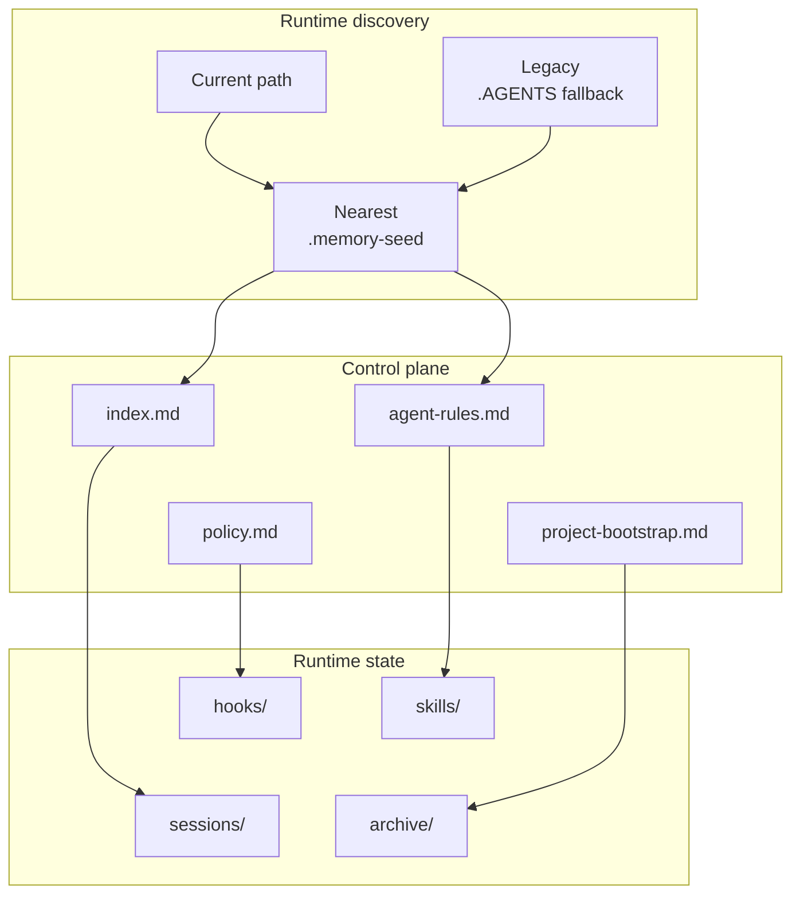

### E. Routing files
- Canonical `AGENTS.md` (read by Codex, Cursor, and Copilot coding agent natively). Thin per-agent routers that point back to `AGENTS.md`: `CLAUDE.md`, `GEMINI.md`, `.github/copilot-instructions.md`.
- **Non-destructive routing into pre-existing files (new in 2.8).** Because these names collide with files other tools own (e.g. HyperFrames also uses `AGENTS.md`/`CLAUDE.md`), `init`/`update` decide per file by a 4-way ownership branch (`ROUTING_DESTINATIONS` in `core.py`): absent -> write full seed file; **ours** (carries `memory-system-version` frontmatter) -> version-gated archive+replace; **foreign with our markers** -> re-sync the managed block in place; **foreign without markers** -> inject a marker-delimited routing block (`<!-- BEGIN memory-seed -->...<!-- END memory-seed -->` pointing into `.memory-seed/`) appended at end. A foreign file is **never overwritten** - even under `init --force`. The in-place re-sync is gated on block-body equality (`_merge_routing_stanza`, mirroring `_merge_grouped_hook`), so a bare version bump causes no churn (the block carries no version stamp). Retired the legacy "versionless -> clobber" path: an unprovable-ownership file is merged, not destroyed.

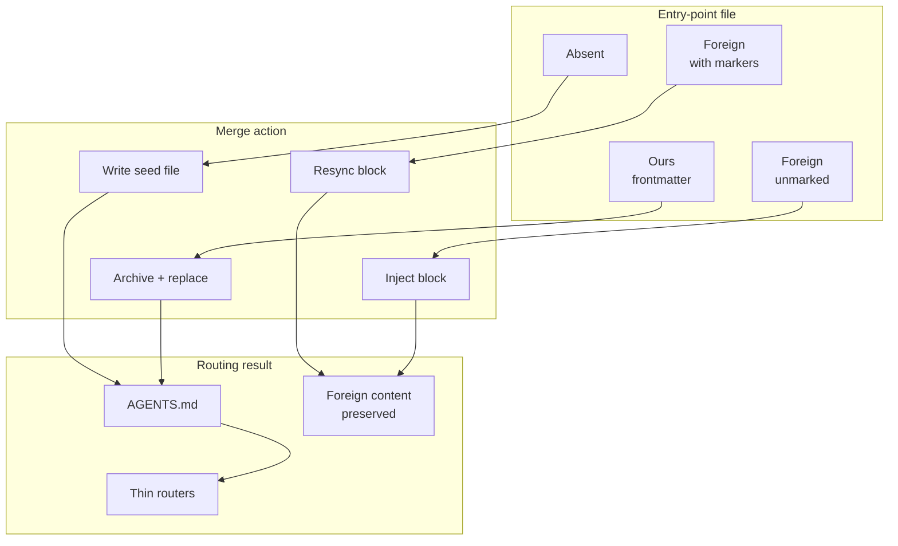

### F. Skills system (`skills/`)
- `index.md` is a **deterministic trigger registry**: each skill listed with `required`, `load_when`, `do_not_load_when`, and an optional `persona:` scope. Agents read it at startup and **lazy-load** only the full runbooks that match the task.
- Current runbooks (22 total): `agent_collaboration`, `code_search`, `compact_mermaid_diagrams`,
  `data_architecture`, `docx_render_windows`, `document_ingestion`, `end_of_turn`,
  `history_retrieval`, `local_compilation`, `memory_consolidation`, `memory_doctor`,
  `memory_hygiene`, `office_document_editing`, `proposal_lifecycle`, `release_publishing`,
  `risk_signaling`, `security_triage`, `session_logging`, `skill_architecture`, and
  `subproject_runtime`, plus
  persona-scoped `copywriter-conversion` and `developer-rendered-ui-debugging`.
- `proposal_lifecycle` is path-aware: this repository uses `docs/1_Inbox/` -> `docs/2_Todo/` ->
  `docs/5_Completed/` with `docs/3_Spec/` and `docs/4_Reference/`; newly initialized projects
  can still use the generic bootstrap anchors `docs/inbox/`, `docs/todo/`, `docs/todo/completed/`,
  and `docs/reference/`.
- **Fan-Out Recipe in `agent_collaboration` (new in 2.14).** A named "Explore / Plan / Implement / Validate" 9-gate pipeline (Scope, Exploration, Plan, Worker Identity, Worktree, Pre-Review Validation, Integration, Bounded Review-to-Rework Loop capped at 2 iterations, Final Handoff), new task-packet fields (`base_sha`, `expected_pwd`, `integration_artifact`, `capability_tier`, `shared_file_policy`, `conflict_owner`, `preflight`, `review_loop`), and vendor-neutral capability-tier guidance (planning and review both frontier-tier). From `docs/5_Completed/agent-fanout-workflow-plan.md`.
- **Branch history preservation (shipped).** `agent_collaboration.md` distinguishes worktree
  isolation from visible Git topology: a worktree alone does not create a branch in the graph.
  Distinct parallel writing tasks get separate branches/worktrees, and integration uses
  `git merge --no-ff` when branch-and-merge shape matters. The read-only `branch status` command
  surfaces this as a warning/guidance check for all agent types.

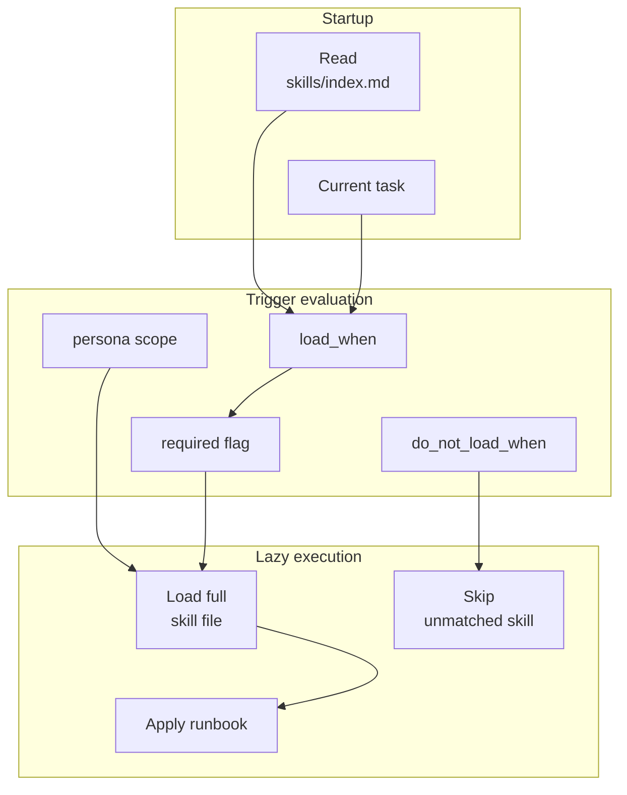

### G. Personas (`.agents/`)
- Vendor-neutral persona templates (developer, content-creator, researcher, sales-rep, solo-founder, copywriter) + `_registry.yaml`. Each defines identity, memory protocol, rules, skill routing, and an append-only `## Project Adaptations` log.
- **Persona evolution** is approval-gated: at session end an agent may draft <=3 adaptations and must get user approval before editing the persona file. Persona selection remains runtime context and is not stored in session entries.

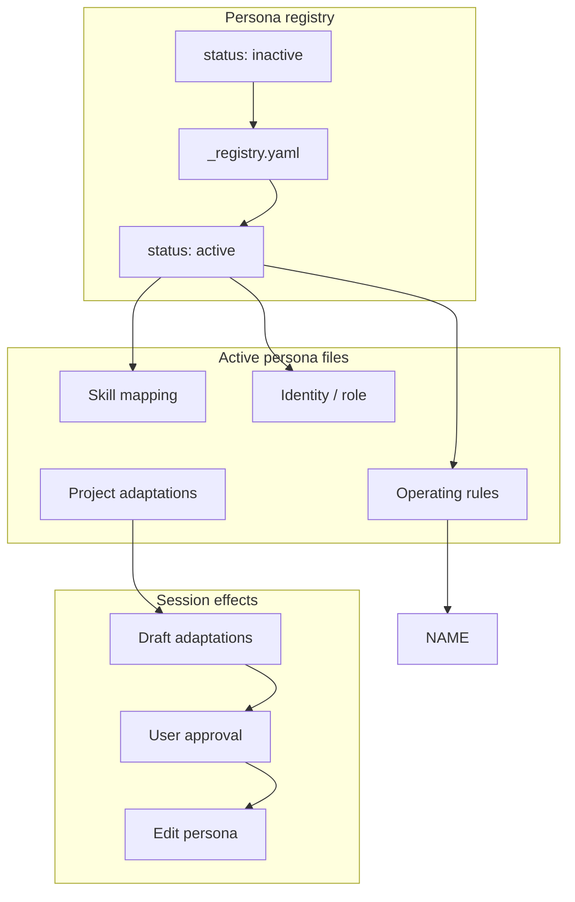

### H. Lifecycle hooks (`.memory-seed/hooks/`, auto-merged per agent)
| Script | Fires | Does |
|---|---|---|
| `session-start-context.py` | session start | Directs the agent through the nearest `AGENTS.md` and `orientation.md`, then consumes the shared, deterministic `situate` report. It injects measured checkout/git/integration facts and the latest applicable session file's path and size, but no session bodies and no model output. Files at or below 12,000 characters are read whole by the primary agent; larger files route to a read-only economy worker for an at-most-800-token, source-linked whole-file briefing, with direct-read and entry-boundary chunking fallbacks. User-aware since 2.10: selects the **active user's** applicable file and reports same-day co-contributor file counts. Its user resolution mirrors `session_target()`'s participant-count gate so it reads whichever file that function writes to. **One-time identity-setup offer (new in 2.14):** if no local identity is configured at all, offers once to run `memory-seed user set <slug>`, tracked by a gitignored `.memory-seed/.identity-offer-stamp` so it never repeats. |
| `memory-retrieval-check.py` | before a prompt/turn | Reminds the agent to use the SessionStart/`situate` route for current state and `memory_search` only for **topical** recall; throttled ~once per session. |
| `session-log-check.py` | turn end | Delivers immediate, repeatable session-record checkpoint debt when tracked/untracked worktree state or `HEAD` changes relative to the latest valid entry baseline; a new valid entry clears and re-baselines it. After 15 clean read-only minutes it delivers exactly one non-escalating self-check for that latest entry, with no debt or miss counter. The versioned gitignored JSON state is atomic, backward-compatible, and fail-open; one canonical evaluator serves the hook, CLI `session checkpoint`, and MCP `memory_session_checkpoint`. Mechanical clearance v1 proves only tracked whitespace-only changes from a clean baseline and refuses every broader case. User-aware: checks only the **active user's** file. Also warns on out-of-order entries. |
| `prepare-commit-msg.py` | git commit message preparation | Stamps `Memory-Entry: <entry_id>` trailers for staged session entries. The installed git hook shim lives in the git common dir so it covers all worktrees; `hooks status` audits it, `hooks repair` refreshes missing/stale Memory Seed-managed shims, and foreign hooks are never overwritten. On Windows the shim uses the active Python executable directly to avoid Git-for-Windows shell startup failures. |

Per-agent event names differ (Claude/Codex: `SessionStart`/`UserPromptSubmit`/`Stop`; Gemini: `SessionStart`/`BeforeAgent`/`AfterAgent`; Cursor: `sessionStart`/`afterAgentResponse`; Copilot CLI/cloud: `sessionStart`/`agentStop`/`postToolUse`). Session checkpoint debt blocks on blocking turn-end hosts and repeats on later real turns; Claude/VS Code also use one blocking delivery to make the otherwise non-escalating clean self-check model-visible, then the continuation-loop guard suppresses replay. Other lifecycle hooks remain advisory. The user-aware paths fall back to legacy flat-file behavior when no user is configured.

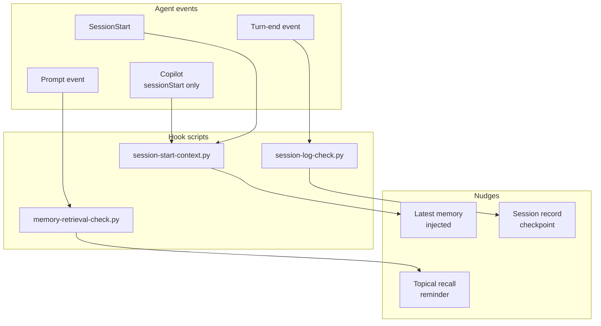

### I. MCP memory retrieval and control preview
- **Current tool families.** Retrieval (`memory_search`, `memory_get_chunk`, Retrieval Specification
  preview/resolve), guarded authoring/integration (`memory_session_append`, `memory_session_integrate`),
  graph/topic/ADR inspection, worktree and branch posture, Design Discovery evidence/assessment, Task Packet
  compilation/rendering/governance loading, provenance, telemetry, and ESR all expose the same core services
  as the CLI. Read-only tools never grant write authority; write tools preserve the same structural guards as
  their CLI counterparts. Design Discovery v2 and Git-common telemetry shipped in `2.24.0`.
- `mcp_server.py`: a dependency-light **stdio JSON-RPC** server. Retrieval tools are `memory_search` (ranked entries/sections), `memory_get_chunk` (full text for one `chunk_id`), inline/profile-aware `memory_retrieval_spec_preview` and `memory_retrieval_spec_resolve`, and the read-only `memory_task_packet_preview` / `memory_task_packet_compile` pair. The Task Packet tools return derived artifacts inline and accept no export path. Authoring tools split into a read-only pair and a write pair: `memory_link_suggest` (rank older entries to link — paste-ready `related_entries`) and `memory_link_show` (one entry's graph node) remain read-only, while `memory_session_append` (author an entry through every write-time guard; `dry_run` pre-flights) and `memory_session_integrate` (merge + fuse a task branch) are the MCP **write** path. Together they close the write-side loop the retrieval tools open on the read side. The earlier read-only `memory_session_target` and `memory_entry_id` tools were removed and subsumed by `memory_session_append`'s `dry_run`. Topic-management tools are `memory_topics_list`, `memory_topic_inspect`, and `memory_topics_check`, all read-only wrappers over the project-local topic index and `topics check` semantics. Collaboration/control-preview tools are `memory_branch_status` (read-only branch/worktree posture), `memory_worktree_guard` (read-only agent namespace pre-write classification), `memory_worktree_home` (persistent home lifecycle), and `memory_session_fuse_preview` (read-only branch-local session/sidecar fuse plan). Since 2.16, retrieval is a **thin wrapper over `retrieval.py`** with a byte-identical tool contract (parity-tested).
- `retrieval.py` (**shipped in 2.16.0 - Memory Trace distribution Phase 1**): the public, MCP-independent retrieval service every consumer rides - `search_memory()`, `get_chunk()` (opt-in `include_diagrams`), `resolve_semantic_provider()`, the canonical `ranked_to_dict`/`chunk_to_dict` result dicts, the `EntryRollup`/`rollup_entry_matches()`/`rollup_entry_results()` entry-level rollup contract (one visible result per session entry; `best_match_chunk_id`, `matched_sections`, `score_source`), and `entry_diagram_sidecars()`. MCP wraps it; Memory Trace imports it as its frozen surface.
- **MCP skill surface (shipped).** `skills/index.md` routes tools to the same lazy-loaded runbooks as their CLI workflows. Most tools are read-only, but MCP is not a read-only surface: session append and integration are guarded writes, and Task Packet, ADR, discovery, provenance, and telemetry adapters reuse their core validation. Constitution v2.5's write-surface parity rule requires every memory write to pass identical validation regardless of surface. Topic-index edits and root-write overrides remain CLI/direct-file operations with the normal authorization gates.
- `semantic_cache.py`: `extract_memory_chunks()` parses `sessions/*.md` into typed `MemoryChunk`s (entry- or section-granularity; `session_date` derived from filename; `entry_id` as `chunk_id`). `rank_memory_chunks()` combines **lexical + semantic + recency** signals:
  `final = (lexical_score + 3-max(semantic,0)) - recency_multiplier`, with semantic via Model2Vec (`model2vec:minishlab/potion-base-8M`, lexical fallback) and an exponential recency decay floored at `recency_floor`.
- **Metadata + filters.** `memory_search`/`memory_get_chunk` expose session/user identity, source paths,
  DRAFTS record kind, topics, source references, graph lineage, successor heads, and attention diagnostics.
  Search accepts user/date/topic filters, preferred keywords, optional semantic ranking, opt-in attention
  boost, and opt-in removal of replaced records. Supersession damping and bounded successor lift remain
  default-on but never erase history.
- **Related-entry graph (shipped and extended).** `build_related_entry_graph()` combines authored
  `related_entries`, decision-granular sidecar edges, computed backlinks/inverses, ADR membership, refinement
  chains, and append-only retractions. Derived importance/connectivity remain read-time projections rather
  than historical rewrites.
- **Automatic decision-level lifecycle classification (shipped in 2.23.0).** Two independently validated
  classifier runs can write live, retractable `source: derived` edges with confidence and a grounding quote.
  `replaces` and `refines` require agreement; weaker/disagreeing results fall back conservatively. Optional
  human verification raises weight, and append-only retraction is the correction path. Decision edges never
  get projected up to entry-level claims or move ADR heads automatically.
- `mcp_validate.py` + `memory-seed-mcp-validate`: human-validatable search/fetch harness.

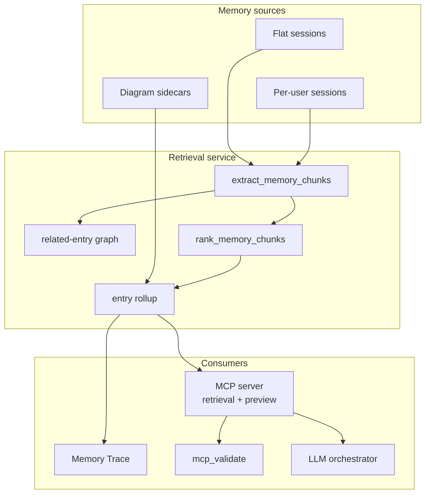

### J. Session log model
- Append-only dated files write to `sessions/YYYY-MM/YYYY-MM-DD.md` or `sessions/YYYY-MM/YYYY-MM-DD/<user>.md`; legacy flat/day layouts remain readable. Entries carry identity, agent, project, branch, topic, source, and relationship metadata. Historical entries may still contain the retired `agent_name` key; readers ignore it. The current **DRAFTS** structure supports typed Decision and Documentation records under `### Records`: every record needs `D:` plus an indented `Scope:`; decisions also need `Disposition:` and `R:`; `A:`, `F:`, `T:`, and material-source `S:` remain contextual evidence. Strict ascending-time, append-at-end chronology is enforced by the sanctioned writer.
- **Entry IDs (widened in 2.12).** New generated `entry_id`s use deterministic 80-bit `mse_` Base32 IDs (`generate_session_entry_id()`); legacy 32-bit `ms-` IDs remain valid and are never rewritten.
- **Integrity validation (new in 2.12, grouped-aware after current work).** `check_session_links()` / `memory-seed links check` scans for duplicate `entry_id`/`hash_id` and dangling refs, exiting non-zero as a CI gate. The legacy-flat `related_entries` scan gap was fixed in 2.14. It also validates `supersedes` refs (dangling/self/postdates/cycle), `commits:` hashes (malformed/unknown when git is present), and decision-diagram sidecars under both `sessions/diagrams/YYYY-MM-DD.md` and `sessions/diagrams/YYYY-MM/YYYY-MM-DD.md` (`malformed-diagram`, `orphan-diagram`, `diagram-date-mismatch`; sidecars always optional).
- **Decision diagram sidecars (shipped).** Authored reasoning diagrams append to `sessions/diagrams/YYYY-MM/YYYY-MM-DD.md`; legacy paths remain readable. Full Mermaid blocks are keyed by entry and timestamp, so corrections append rather than rewrite. Spatial, temporal, topology, migration, compatibility, multi-agent, lifecycle, and retrieval-pipeline decisions are positive authoring triggers, with omission reasons recorded when no diagram is useful.
- **Decision Harvest (shipped).** Before choosing an entry shape, `session_logging.md` and `end_of_turn.md` list every durable choice, classify Decision versus Documentation, and select one record, numbered records, or separate entries. Source attribution and lifecycle prompts prevent broad records from hiding distinct choices or their ancestry.
- **Evidence-backed session checkpoints (shipped in 2.23.0).** Hook, CLI, and MCP share one evaluator for pending session-record debt after worktree or `HEAD` changes. A valid later record re-baselines it; mechanical clearance v1 is deliberately limited to proven tracked whitespace-only changes from a clean baseline.
- **Branch-session fuse and one-step integration (shipped).** `session fuse` remains the lower-level preview/apply primitive. `session merge-branch` and `session integrate` compose fuse validation, `--no-ff` integration, session-tree reconstruction, guarded commit, and exact worktree cleanup or home parking. They fail closed on provenance, chronology, sidecar-parent, conflict, or cleanup uncertainty; branches are preserved.
- **Evolution edges and artifact lineage (core shipped in 2.18.0; Trail continuity shipped 2026-07-15).** Implements `docs/5_Completed/evolution-edges-plan.md`: (1) a typed `evolves:` edge - "this entry extends that decision, which remains valid" - with a read-time-only computed `evolved_by` inverse that never dampens `importance_score` and never feeds `exclude_superseded` (the semantic line vs. `supersedes`); (2) append-only enforcement via the `authored-inverse-field` links-check guard (a stored `superseded_by:`/`evolved_by:` key is a named integrity error, not a silently ignored no-op); (3) the structured `continuity:` field (`kind: rename|migration|removal` with `from`/`to`; `to` forbidden on removal) recording artifact lineage as historical labels, validated structurally (`malformed-continuity`); (4) rarity-weighted `F:` file-overlap ranking in `link suggest`/`memory_link_suggest` with per-suggestion `shared_files` evidence, alias-resolved transitively through recorded renames (boost-only - hub files contribute ~nothing via idf, absent `F:` is never penalized); (5) computed `superseded_by`/`evolved_by` on every `memory_search` result; (6) Decision Harvest lifecycle prompts in the live/seed skills; and (7) derived Trail continuity lanes for rename, migration, and removal events without adding authored graph edges. Forward-only guards (`dangling`/`self`/`postdates`/`cycle`) run independently per edge kind.
- **Supersession successor surfacing (shipped 2026-07-15).** Every retrieval result now exposes the terminal `superseding_head` for its supersession lineage. The default-on successor boost is lineage-bounded and graduated only after fixtures plus `memory-seed ranking-ab` proved all live replacements out-rank their retired predecessors with an unchanged unaffected-query control. See `docs/5_Completed/supersession-successor-surfacing-proposal.md`.
- **Automatic lifecycle-link classification (shipped in 2.23.0).** `memory-seed link audit --date <date> --apply` still writes idempotent `classify_pending: true` stubs, but the optional two-run `link_swarm` now classifies those candidates automatically. `memory-seed link batch-apply --run-dir <run1> --agree-with <run2>` writes mechanically validated, live, retractable `source: derived` edges with a grounding quote and confidence. `replaces` and `refines` require agreement between both runs; weaker or disagreeing outcomes fall back conservatively. `memory-seed link verify <source> "<ref>" --by <initials>` is optional and raises a previously machine-classified edge to full retrieval weight. Stubs remain warnings only when no automatic run has resolved them.
- **Reflection Board v1 retired (2026-09-22).** The former CLI/MCP command family, sequential ledger modules, profiler, packet capability, ESR projection, hook admission, project toggle, and live/seed operating instructions have been removed. Ordinary session append/fuse/merge/PR, packet scope checks, MCP tools, ESR, worktree guards, and `Memory-Entry` stamping remain. The one historical ledger and public trust anchor were reconciled into linked ordinary session receipts before their conditional active-tree removal; exact identities and Git history remain recorded. A first real chain was evaluated and closed on 2026-09-08; the later integrated launch-verification Todo was withdrawn, not passed. The [retirement record](../5_Completed/reflection-runtime-retirement-superpowers-plan.md) and [historical operator guide](../4_Reference/reflection-board-v1-operator-guide.md) retain rationale and the former contract.
- **Configurable integration mode (shipped 2026-07-15).** `integration_mode: local-merge|pr` now governs the live/seed agent contract and mode-aware `session integrate`/`session open-pr` flow; bootstrap suggestions require human confirmation. See `docs/5_Completed/configurable-integration-mode-plan.md`.
- **Multi-user session memory (phased).** `iter_session_documents()` now reads four layouts: legacy flat (`sessions/YYYY-MM-DD.md`), legacy per-day/per-user (`sessions/YYYY-MM-DD/<user>.md`), grouped flat (`sessions/YYYY-MM/YYYY-MM-DD.md`), and grouped per-user (`sessions/YYYY-MM/YYYY-MM-DD/<user>.md`). `memory_search`, `memory_get_chunk`, Memory Trace, hooks, `links check`, and `compact` consume that shared iterator. `session_target()` writes new flat targets to `sessions/YYYY-MM/YYYY-MM-DD.md`; when the per-user gate applies it writes `sessions/YYYY-MM/YYYY-MM-DD/<user>.md`. `--create` initializes per-user file frontmatter (`schema_version: 2`, `session_date`, immutable `hash_id`, `user`, `created_at`). Historical files are moved only by explicit migration.
- **Participant-count layout gating (new in 2.14).** A configured user alone no longer fragments the log: `session_target()` only honors an *ambiently*-resolved user (env var or `local.yaml`) once `.memory-seed/project.yaml`'s `participants:` list has 2 or more entries - with 0 or 1, it stays on the shared grouped flat file, since per-user files exist to avoid concurrent-author conflicts that don't arise until there's a second author. An explicit `--user <slug>` CLI override still bypasses the gate (a deliberate one-shot choice). `doctor` separately warns (non-fatal) when a configured local user has no matching `participants:` entry. This repository has one participant registered (`jean`, initials `JNL`), so it correctly stays on the grouped flat layout for new writes.

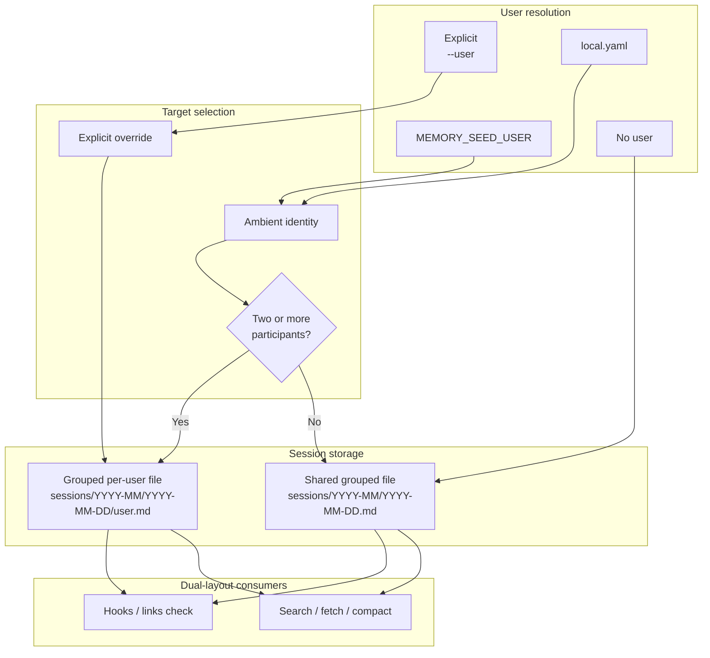

### K. Versioning, seed/live twins, archiving
- `memory-system-version` frontmatter + `core.py VERSION` + `pyproject.toml version` must stay in lockstep (the "version-bump trap", guarded by `test_repo_root_control_plane_files_match_version`).
- Seed templates and the repo's own live runtime are **twins** (parity enforced by tests). `update` is **forward-only** and archives replaced files under `archive/<old-version>/`.

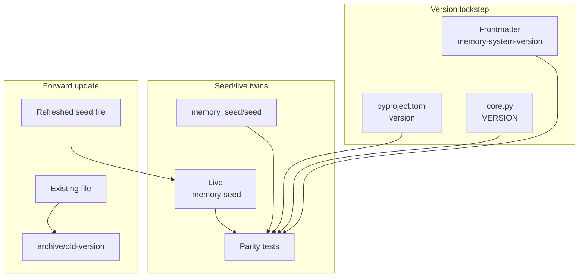

### L. `doctor` health + warnings
- Reports missing files, version mismatches, bootstrap completeness. Non-fatal `warnings` channel covers: Codex MCP status (absent/stale-fixable/stale-manual); **orphan skills** (any `skills/*.md` not registered in `skills/index.md`, since 2.7); **orphaned runtime routing** (new in 2.8 - a `.memory-seed/` runtime exists but a present entry-point file is foreign and carries no routing block); a session-integrity summary pointing at `links check` (since 2.12); and a **local-user/participant mismatch** (new in 2.14; a configured `.memory-seed/local.yaml` user whose slug has no matching `participants:` entry in `.memory-seed/project.yaml`). Foreign routing files are not reported as version mismatches (the host owns the file; Memory Seed only manages its injected block).

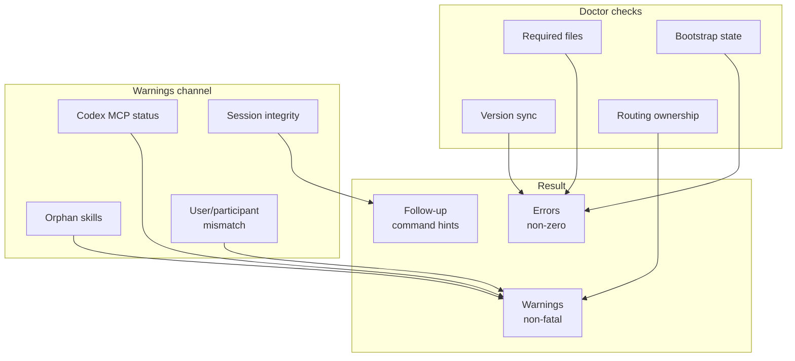

### M. End-of-turn routine (`/esr`)
- The vendor-neutral end-of-session routine lives in `agent-rules.md` "End Of Turn". It runs: session-log append; **consolidation review** (promote durable facts -> `index.md`/`policy.md` via `memory_consolidation`, since 2.11); index/policy review; a diff-scoped **orphan & artifact sweep** (new in 2.7 - confirm additions are wired in, resolve references dangling from deletions/renames, flag scratch debris; optionally run a project's own dead-code tool, never installs one); persona/skill evolution (approval-gated); and a **baseline-promotion check** (flag generic adaptations for reuse, record in `.memory-seed/plans/`, since 2.11).
- Shipped as a seeded **`/esr`** command (new in 2.11) for agents with a repo-level command mechanism: Claude (`.claude/commands/esr.md`, version-tracked) and Gemini (`.gemini/commands/esr.toml`, deploy-once). Codex/Cursor run the routine directly from `agent-rules.md`. **No blocking `Stop` hook** - evolution needs reasoning + user approval a hook cannot provide.
- **Two degradation reports added 2026-07-21/22**, both for failures that were true-but-invisible - stated only in a field no human reads:
  - **Semantic ranking.** `esr` probes the embedding provider exactly as search does, printing `OK - <provider>` or `DEGRADED - ranking is lexical only` with the reason and the fix. Worded as *degraded*, not an error: search still answers, nothing in the results themselves reveals which mode produced them, and the `--no-deps` lightweight install is a supported configuration rather than a broken one. Found because this repo's own interpreter had `memory-seed` installed *without* its declared dependency, so every search had silently fallen back to lexical.
  - **Decision-diagram coverage.** How many of the session's entries carry a sidecar, plus the date of the last sidecar *anywhere* - the second number is the load-bearing one, because a lapse is only visible as a RUN of empty days, which no single day's view shows. Deliberately a count and **not** a verdict on whether a given entry warranted a diagram: a keyword trigger heuristic over the skill's own positive-trigger list was prototyped, flagged 35% of all corpus entries (matching "worktree" in a passing validation line, "topology" in a feature name), and was dropped - both as noise and because judging authoring intent contradicts this routine's own rule that judgment stays with the agent.

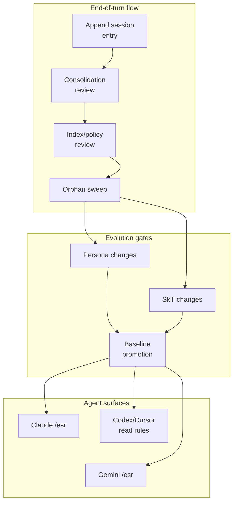

### N. Release / publish flow
- GitHub Release -> `publish.yml` builds, runs tests, then pauses at the `pypi` manual-approval gate before the OIDC push. Release commits land on `main`.

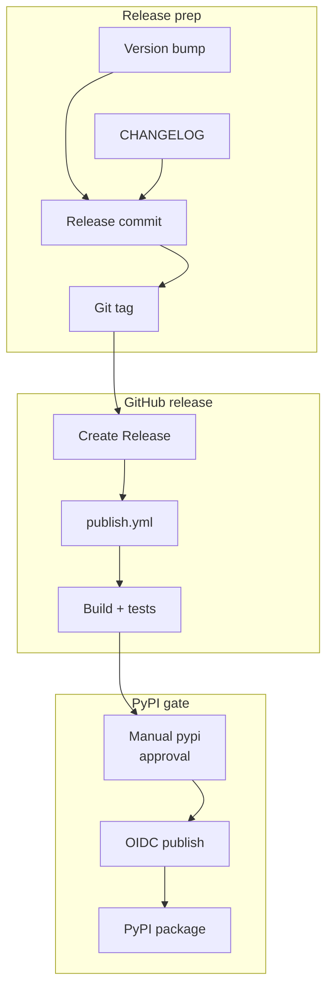

### O. Memory Trace (review UI; legacy Lense name retired)
- The review UI shipped in 2.13 as the in-package `memory-seed[lense]` extra ("Memory Lense") and was **extracted** into a separate `memory-trace/` source/product boundary (Arc 1 of the Memory Trace roadmap). The public install path is now `memory-seed[trace]`, which exposes the `memory-trace` command while importing the public retrieval service (`memory_seed/retrieval.py`). The `memory-seed[lense]` extra and `memory-seed lense` command were a deprecated alias kept for one release window and were **removed for the 2.20 release** (Track A.4). Plain `memory-seed` ships **no** web framework.
- Serves search, filters, timeline, graph, and reader/details views over the same `semantic_cache` parsing/ranking + `retrieval` service MCP uses - no forked retrieval logic (parity tested across the Trace source boundary). Controlled entry-YAML `topics:` and project-local `.memory-seed/topics.yaml` now run end-to-end through parser, retrieval, CLI, MCP, and Trace chronological topic chains; deterministic read-only `topics suggest --from <file>` completed the plan on 2026-07-15. Historical entries still use the hashtag/heading fallback. See `docs/5_Completed/memory-trace-topic-neighbourhoods-plan.md`.
- **Cache architecture:** a rebuildable local SQLite cache stored **outside the repository** (`%LOCALAPPDATA%\memory-seed\lense` on Windows, `~/.cache/memory-seed/lense` elsewhere; keyed by a hash of the workspace root, with a `tempfile` fallback if the cache directory isn't writable). Phase 1 now uses a schema-versioned git-watermark plus dirty-signature freshness check, a short freshness memo, memoized chunks/derived structures, and full wipe-and-atomic-replace on rebuild; a cross-process rebuild lease serializes shared-cache writers, and a bounded lease wait falls back to a per-process temporary projection rather than surfacing Windows file contention as a UI failure. Ambiguity fails toward rebuilding and no-git projects fall back to tracked-document metadata. The cache is never authoritative and Markdown stays the source of truth.
- **Incremental startup (shipped 2026-07-21; `PROJECTION_SCHEMA_VERSION` 2).** The derived-projection plan's last deferred piece. Immutable git derivations are persisted by SHA (`fork_points`, `commit_parents`, `changed_paths`) and carried across rebuilds, since a commit's parents and diff can never change; reconciliation is incremental over changed documents only; and the file→entry index is built lazily on first use rather than at startup. Fork points are computed in-process by maximal-common-ancestor, with `git merge-base` retained only for criss-cross cases. Measured on the real corpus: forced rebuild 44.25 s / 990 git subprocesses → 1.46 s / 7; live warm start 308 ms, one changed file 1.15 s, one new commit 1.62 s, one merge 2.20 s. The acceptance bar was explicitly *not* "the warm cache is fast" — it already was.
- **Decision-diagram viewer (React, 2026-07-22).** The diamond badge in the Trail and each diagram figure in the reader open a modal zoom/pan viewer (`role="dialog"`, Escape and backdrop-click close). Before this the badge was an inert `<span>` reading "open the entry to view", and opening the entry rendered the diagram inline in the narrow inspector column. The zoom arithmetic lives in `diagramZoom.ts` as pure, unit-tested functions; real Mermaid now renders the maintained inline and modal surfaces.
- **Launch ergonomics:** `memory-trace` starts one local server and opens the React UI at `/`; `/next`
  redirects existing bookmarks. The source checkout's `scripts/launch-memory-trace.ps1` supplies the
  local import path and reuses a healthy Trace process on the chosen port.
- **Deterministic Evidence Packs (Phase 1 shipped 2026-07-15).** `memory_trace.evidence.build_timeline_evidence_pack()` creates normalized, fingerprinted, snapshot-tested evidence over bounded date/entry/topic/user/agent/graph-neighbourhood selections. It includes entry/section, edge, commit, and diagram provenance, invokes no provider, writes no memory, and is non-authoritative. Provider/local-model summarisation remains Phase 2 in `docs/8_Deferred/memory-trace-ai-timeline-summarisation-plan.md`.
- Content-addressed React assets under `memory-trace/memory_trace/static/react/`, the manifest,
  fonts, and independent renderer benchmark ship inside the root `memory-seed` wheel/sdist.
- **Next-generation planning (promoted 2026-07-11):** `docs/7_Replaced/memory-trace-product-and-system-architecture-blueprint.md` is the top-level product/system entry point; `docs/7_Replaced/memory-trace-next-generation-implementation-roadmap.md` sequences the future API/React/Trail/evidence/hosted phases; `docs/7_Replaced/memory-trace-next-generation-coverage-matrix.md` explains which older plans remain active; and the new live specs are `docs/3_Spec/memory-trace-trail-search-and-graph-ux.md` plus `docs/3_Spec/memory-trace-derived-artifact-provenance-contract.md`.

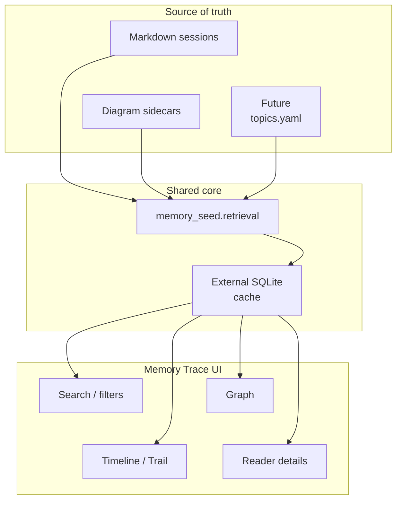

### P. Hosted team edition (separate, non-packaged)

- `hosted/` is a self-contained local-development surface for the separately governed team edition. It is
  intentionally excluded from the published `memory-seed` package; the local OSS edition remains useful
  offline with no account, server, database, or hosted dependency.
- **P0.1 authority is integrated.** Constitution v2.5 and the edition contract keep ordinary local Markdown
  authoritative while the hosted substrate is built and rehearsed. There is no repository synchronization,
  hidden settlement, or dual-writer mode.
- **P0.2 offline capture is implemented.** A write agent explicitly submits a first-hand decision marker;
  capture validates version/checkpoint identity and queues JSONL events into disposable SQLite. Accepted
  records remain source-linked and inert until governed use. The provider-neutral advisory curator compares
  an accepted record with existing decision/topic candidates before opening any bounded source question.
- The frozen evaluation corpus contains 103 formal records (100 Decisions and three Documentation controls)
  plus synthetic reliability controls. Historical marker-assisted source-window recall was 89.6% (60/67),
  below the 95% gate and not a measure of autonomous extraction. Historical source-alignment research is
  paused; rejected label material must be rebuilt and independently reviewed before it can gate delivery.
- **PostgreSQL R0 is complete; R1 is next.** `hosted/importing/` now carries the full-corpus field/actor
  inventory and crosswalk. R1-R5 sequentially build the secure substrate, parity import/export, transfer
  rehearsal, capture/evidence service, and authenticated useful loop while Markdown remains authoritative.
  R6 is a separate human-gated managed-PostgreSQL pilot requiring the exact manifest, restore receipt, and
  authority epoch to be approved before hosted authority can move.
- Hosted raw evidence is owner-only; curated records may be shared under project policy. Removal is a
  last-resort governed action that leaves a content-free tombstone.

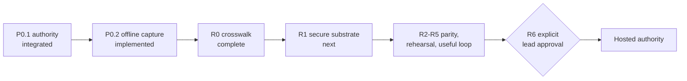

---

## 4. Data-flow diagrams

### 4.1 `init` / `update` - install & merge

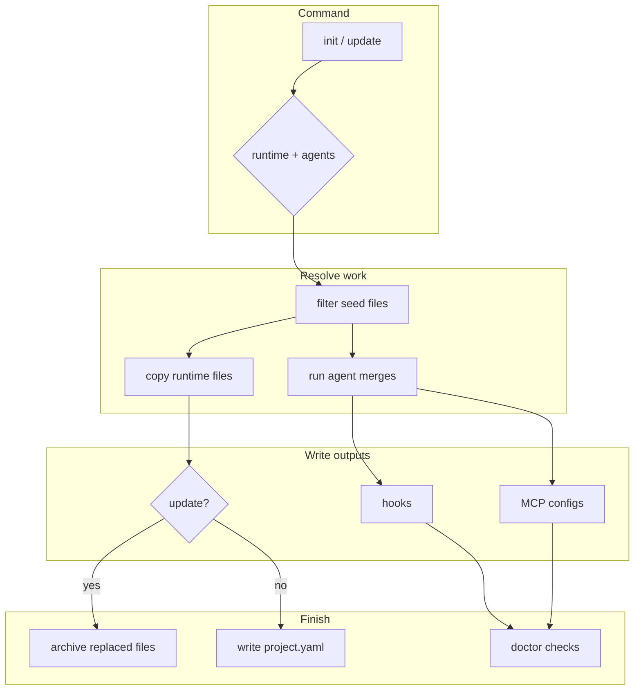

### 4.2 MCP retrieval pipeline

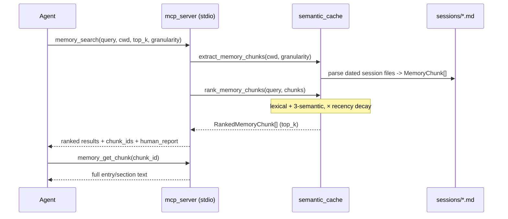

### 4.3 Session lifecycle (recency vs. topical retrieval)

```mermaid
graph TD
  subgraph Start["Start"]
    direction LR
    S["Session start"] --> H1["inject newest entry"]
  end

  subgraph Work["Work loop"]
    direction LR
    R["read rules/index/session"] --> W["edit and decide"]
    W --> H2["topical memory recall"]
  end

  subgraph Close["Closeout"]
    direction LR
    EOT["End Of Turn"] --> SW["sweep artifacts"]
    EOT --> LOG["append DRAFT entry"]
    LOG --> H3["log check"]
  end

  H1 --> R
  H2 --> EOT
  H3 --> S
  Start ~~~ Work
  Work ~~~ Close

```

### 4.4 Agent config wiring

```mermaid
graph TD
  PROJ["project.yaml<br>agent selection"] -. gates .-> REG["KNOWN_AGENTS<br>+ merge ops"]

  subgraph Agents["Agent-specific outputs"]
    direction TB
    CL["Claude<br>CLAUDE.md + .mcp.json"] ~~~ CO["Codex<br>.codex config"]
    CU["Cursor<br>.cursor config"] ~~~ GE["Gemini<br>GEMINI.md + settings"]
    CP["Copilot<br>instructions + .github/.vscode"]
  end

  REG --> CL
  REG --> CO
  REG --> CU
  REG --> GE
  REG --> CP

```

---

## 5. Quality goals & non-functional requirements

The qualities the design optimises for (the "why it is shaped this way"):

- **Local-first / offline.** Core operations (init/update/doctor/compact, retrieval) need no network. Nothing is sent to a remote service.
- **Minimal dependency.** The CLI and core run on the standard library; the only runtime dependency is `model2vec` (for semantic ranking), and retrieval **degrades to lexical** if semantic scoring is disabled or fails.
- **Portable / cross-platform.** Windows, macOS, Linux; Python >= 3.11; hook output is ASCII-safe so it survives any console encoding.
- **Vendor-neutral.** One canonical `AGENTS.md` + thin per-agent routers; no agent is privileged. New agents are added via a registry, not scattered special-casing.
- **Human-readable & durable.** Plain Markdown + YAML, predictable paths, git-friendly diffs; no binary store that could rot or lock.
- **Deterministic where it matters.** The skill trigger registry, recency-by-filename-date reads, and append-only chronology are deterministic, not model-judgement.
- **Non-destructive.** `update` is forward-only; replaced files are archived; `remove`/`--force` back up first; foreign agent config is preserved.

## 6. Constraints & assumptions

- **Python >= 3.11** (uses `tomllib` and modern typing).
- **Stdlib-only core; `model2vec>=0.8.1` is the single declared runtime dependency** (it pulls `numpy`). A project that never uses semantic search still installs it.
- **Markdown + YAML, no database.** All state is files; there is no migration engine beyond `update`'s forward-only archive.
- **Session model is grouped and multi-user compatible (phased).** The current default write target is one shared month-grouped file, `sessions/YYYY-MM/YYYY-MM-DD.md`. Readers still support the legacy shared file (`sessions/YYYY-MM-DD.md`) and legacy per-user file (`sessions/YYYY-MM-DD/<user>.md`) indefinitely. The per-user grouped layout (`sessions/YYYY-MM/YYYY-MM-DD/<user>.md`) avoids concurrent-author Git merge conflicts. **Per-user layout additionally requires 2+ registered `participants:`** (new in 2.14) - a lone configured user stays on the grouped flat file regardless, since per-user files exist to avoid concurrent-author conflicts that don't arise with a single author. This repository has a local user configured (`jean`, participant registry entry with initials `JNL`) but only that one participant registered, so new entries correctly stay on the grouped flat layout; entries only fragment into `sessions/YYYY-MM/YYYY-MM-DD/<user>.md` once a second participant is added.
- **OneDrive-synced repos.** This project lives in a cloud-synced folder, so a cache **must not** use Drive-synced SQLite (corruption risk). The Memory Trace cache (section 3O, originally shipped under the Lense name in 2.13) honors this by storing its SQLite file outside the repository entirely (`%LOCALAPPDATA%`/`~/.cache`) rather than gitignoring an in-repo file - no cache file ever sits inside the synced folder.
- **Version lockstep.** `memory-system-version` frontmatter, `core.VERSION`, and `pyproject.version` must move together (guarded by a test).
- **Agent cooperation assumed.** Agents are expected to honour the `AGENTS.md` read order and the End Of Turn routine; hooks can only *nudge*, not enforce.

## 7. External interfaces & contracts

- **MCP tools (stdio JSON-RPC):**
  - `memory_search(query, cwd=".", top_k=8, granularity="entry"|"section", semantic_enabled, recency_enabled, lambda_days, recency_floor)` -> ranked chunks (`chunk_id`, scores, matched terms/fields) + a `human_report`.
  - `memory_get_chunk(chunk_id, cwd=".")` -> full entry/section text for one id.
  - `memory_link_suggest(cwd=".", entry_id=null, top_k=5)` -> `target` summary + ranked `suggestions` + paste-ready `related_entries` (read-only).
  - `memory_link_show(entry_id, cwd=".")` -> one entry's graph node: `outbound`/`inbound`/`supersedes`/`superseded_by`, `importance_score`, `commit_reference_count` (read-only).
  - `memory_session_append(title, body, user_initials, agent_type, ...)` -> appends a session entry through every write-time guard (chronology, ref existence, forward-only edges, topic vocabulary, id collision, DRAFT format); refusals return `{ok: false, issues}`. `dry_run` returns the resolved target path, the canonical `entry_id`, the `timestamp`, and `rendered` — the exact block a real call would append — without writing; when committing after a preview, echo the returned `timestamp` into the real call so a minute tick cannot change the id. The only MCP path that authors an entry.
  - `memory_session_integrate(branch, cwd=".", dry_run=false)` -> merges a task branch and fuses its branch-local session memory into the trunk in chronological order; aborts to a clean tree on a non-session conflict, declines `pr` integration mode.
  - `memory_topics_list(cwd=".")`, `memory_topic_inspect(topic, cwd=".")`, and `memory_topics_check(cwd=".")` -> read-only topic vocabulary listing, alias-aware single-topic inspection with entry usage, and validation mirroring `memory-seed topics check`.
  - `memory_branch_status(cwd=".")`, `memory_worktree_guard(agent_type, write_intent=false, allow_root_write=false, cwd=".")`, and `memory_session_fuse_preview(branch, cwd=".", base="HEAD")` -> read-only branch posture, agent worktree namespace classification, and branch-local fuse plan.
- **CLI exit codes:** `0` success, `1` failure (e.g. nothing to do, invalid agent slug, unhealthy runtime).
- **File-format contracts:** session-entry YAML keys (`entry_id`, `user_initials`, `agent_type`, `project_path`, `subproject_path`); per-user session **file** frontmatter (`schema_version: 2`, `session_date`, `hash_id`, `user`, `created_at`, since 2.10); `skills/index.md` trigger schema (`skill`, `required`, `load_when`, `do_not_load_when`, `persona?`); `project.yaml` (`agents:`, `skills:`, `participants:`); `memory-system-version` frontmatter on control-plane files; the routing managed block delimited by `<!-- BEGIN memory-seed -->` / `<!-- END memory-seed -->` in foreign entry-point files.
- **Local user identity:** gitignored `.memory-seed/local.yaml` (`user:` slug) and the `MEMORY_SEED_USER` environment variable select the active user for session targeting and the user-aware hooks (since 2.10).
- **Per-agent config targets:** see the wiring map in section 4.4 (each agent's hook + MCP files).

## 8. Deployment view

Memory Seed is a developer tool, not a service - "deployment" means how the CLI and MCP server reach a machine and a project.

- **Install paths:**
  - `uvx --from memory-seed memory-seed <cmd>` - one-off execution, nothing installed.
  - `uv tool install memory-seed` / `pipx install memory-seed` - persistent machine-wide CLI.
  - `pip install memory-seed` / `uv pip install memory-seed` - into the active virtualenv.
  - `uv add memory-seed` - only when a project itself depends on the package.
- **Runtime placement:** `init`/`update` write control-plane + routing files **into the target project** (no global state beyond the installed package). The MCP server runs as a **stdio subprocess** the agent spawns (`uvx --from memory-seed memory-seed-mcp --stdio`), registered in each agent's config by `init`/`update`.
- **Release pipeline:**

```mermaid
graph TD
  DEV["commit + tag"] --> REL["GitHub Release"]
  REL --> WF["publish.yml<br>build + tests"]
  WF --> GATE{"manual approval"}
  GATE -- approve --> OIDC["OIDC publish"]
  GATE -- hold --> STOP["no push"]
  OIDC --> PYPI["PyPI"]

```

## 9. Cross-cutting concepts

- **Security & privacy.** Public-memory hygiene rule (no secrets, credentials, or unnecessary personal data in memory/logs). PyPI publish uses OIDC with a manual-approval gate. Uninstall strips only Memory Seed's own entries and preserves foreign config. Hooks are read-only and cannot exfiltrate.
- **Error handling & resilience.** Hooks **degrade to silent** on any error (never block the agent). `project.yaml` parsing **fails open** (absent/malformed/no-`agents:` => all agents). `update` is forward-only (cannot downgrade a newer project). `remove` and `init --force` back up before touching files. `doctor` separates hard checks from a non-fatal `warnings` channel. Project-owned text writes now have an explicit UTF-8/LF/NFC helper plus repository `.editorconfig`/`.gitattributes`; **known gap:** file writes are direct, not atomic temp-then-rename - a crash mid-write could truncate a file (see Risks).
- **Persistence & concurrency.** Plain files; session logs are strictly append-only with current-clock timestamps so write order == time order. No file locking; the model assumes a single writer per day.
- **Encoding contract.** Project-owned text artifacts are UTF-8 without BOM, LF line endings, and NFC-normalized. `memory_seed.text_files` is the shared helper for generated text/JSON reads and writes; JSON helpers preserve readable Unicode (`ensure_ascii=False`). MCP stdio output is explicitly Unicode-preserving. `memory-seed encoding check` reports byte/normalization drift, likely mojibake, and implicit production Python text I/O. `encoding repair` uses atomic replacement and timestamped backups for mechanically safe BOM/newline/NFC fixes; invalid UTF-8 and likely mojibake remain manual.
- **Dependencies.** Runtime (required): `model2vec>=0.8.1` (+ `numpy` transitively). Runtime (optional, `memory-seed[trace]` extra only): `fastapi>=0.110`, `uvicorn>=0.27` - the default CLI/MCP path stays dependency-light; `memory-trace` prints an install hint rather than failing when the extra isn't installed. Tests: stdlib `unittest`. No ORM, no message bus.

## 10. Architecture decisions

The living decision log is `.memory-seed/index.md` -> **Design Decisions** (terse, append-only). The records below add the *context -> decision -> consequence* framing for the load-bearing choices.

| # | Context | Decision | Consequence |
|---|---|---|---|
| ADR-1 | Memory must be agent-readable, durable, git-friendly, offline | **Plain Markdown + YAML, no database** | No query engine - retrieval is built in Python (`semantic_cache`); no transactions/atomic writes (see Risks) |
| ADR-2 | Monorepos and sub-projects need isolated memory | **Nearest-runtime discovery** (walk upward to the closest `.memory-seed/`) | `cwd` determines the active runtime; sub-projects can own local memory; legacy `.AGENTS/` kept as fallback |
| ADR-3 | Ranked search buries the newest entry for "what's current" | **Recency over search for current state** - SessionStart hook + direct newest-file read | Two retrieval modes coexist; per-agent SessionStart hooks must be wired |
| ADR-4 | The repo ships templates *and* dogfoods them | **Seed/live twins, enforced by tests** | Every control-plane edit must touch both copies; parity is mechanical, not trusted |
| ADR-5 | Projects already have their own agent config | **Merge (upsert), never copy; preserve foreign entries** | Idempotent per-schema merge helpers; uninstall strips only Memory Seed's own entries, backs up first |
| ADR-6 | Older projects predate agent-selection | **`project.yaml` fails open** (absent => all agents; empty => none) | Backward compatible; a zero-vs-None distinction in the parser |
| ADR-7 | Semantic search shouldn't add heavy infra | **Static Model2Vec embeddings + lexical fallback** | One runtime dep (`model2vec`); graceful degradation to lexical; recency is clock-sourced, not caller-supplied |

## 11. Performance & quality scenarios

Measured on this repository's own corpus on 2026-06-14 (Windows, Python 3.11). Indicative, not contractual.

- **Corpus:** 103 entry-chunks / 277 section-chunks parsed from `sessions/*.md`.
- **Extraction:** ~30 ms to parse all session files into typed chunks.
- **Lexical search (no model):** rank ~27 ms; end-to-end query ~55-60 ms.
- **Semantic search (Model2Vec `potion-base-8M`):**
  - First-ever call: ~3.7 s (includes a one-time ~tens-of-MB model download).
  - Cold per process, model cached: ~1.1 s (model load + embed the corpus once).
  - Warm per query: ~43 ms (~15 ms over lexical once loaded).

**Quality scenarios (target -> result):**
- *Interactive search feels instant after warm-up* (<100 ms/query) -> **met** (~43 ms semantic, ~27 ms lexical).
- *Cold start within a couple of seconds* -> **met** (~1.1 s with the model cached).
- *Retrieval still works with no model present* -> **met** - semantic scores degrade to `None` and ranking falls back to lexical + recency (verified: this benchmark environment had no model installed until explicitly added).

**Scaling note:** parsing and ranking are linear scans over chunks (no index), so cost grows O(entries). At hundreds of entries it is tens of ms; a corpus in the 10k+ range would warrant Memory Trace cache/index work rather than a per-query full scan.

## 12. Risks & technical debt

| Risk / debt | Impact | Status |
|---|---|---|
| Semantic/lexical search buries the newest entry | Agent misreads "current state" | **Mitigated** - SessionStart hook + direct newest-file read rule |
| Legacy 32-bit `ms-` entry IDs | Collisions at large history sizes | **Mitigated since 2.12.0** for new generated entries: `generate_session_entry_id()` now emits deterministic 80-bit `mse_` IDs while existing `ms-` IDs remain valid and are not rewritten |
| Drive-synced SQLite corruption | Rules out the obvious cache backend | **Resolved (2.13.0)** - the Memory Trace cache, originally shipped as Memory Lense, lives outside the repo entirely (`%LOCALAPPDATA%`/`~/.cache`), so no SQLite file is ever placed inside the synced folder |
| Concurrent Trace rebuilds can contend for a shared SQLite replacement on Windows | Fresh sessions could return a 500 while another server owns the cache file | **Mitigated 2026-07-16** - an OS-level per-cache rebuild lease serializes writers; after a bounded wait, the waiting process builds an isolated disposable cache rather than retrying the same shared temporary filename |
| `links check` skipped legacy-flat `related_entries` validation | A dangling `related_entries` ref in this repo's own layout wasn't caught | **Fixed in 2.14.0** - entry-level scan moved out of the per-user-day-only gate; regression-tested |
| Version-bump trap (root files missed by scoped sed) | Shipping mismatched versions | **Guarded** by `test_repo_root_control_plane_files_match_version` |
| `update --dry-run` lists all targets, not just changed | Noisy preview | Documented in README |
| Non-atomic file writes (no temp+rename) | Corruption on crash mid-write | Open - candidate hardening item. Note: Memory Trace's cache *does* use temp-file + atomic `os.replace`, so this gap is specifically about control-plane/session file writes, not the cache. |
| Encoding drift / mojibake on Windows defaults | Corrupted Markdown, JSON, logs, or MCP payload readability | **Mitigated 2026-07-08** - `.editorconfig`, `.gitattributes`, UTF-8/LF/NFC helpers, MCP Unicode output, read-only checks, backup-first atomic repair for safe drift, production implicit-I/O checks, and non-fatal doctor summaries are implemented. Suspected mojibake remains intentionally manual. |
| Concurrent session authors | Multi-author Git conflicts or silently divergent chronology | **Mitigated in the local edition** - grouped shared/per-user layouts, participant gates, guarded append/checkpoint writers, deterministic integration, and branch-session fuse are shipped. Hosted concurrency is a separate SQL/authority-epoch concern covered by R1-R6. |

## 13. Glossary

- **Control plane** - the reusable runtime files (`agent-rules.md`, `project-bootstrap.md`, skills, hooks) versioned by `memory-system-version`.
- **Runtime** - the nearest `.memory-seed/` directory found by walking upward from `cwd`.
- **Seed / live twin** - a template under `memory_seed/seed/` and its byte-identical copy in the repo's own `.memory-seed/` (parity enforced by tests).
- **Routing file** - a thin per-agent file (`CLAUDE.md`, etc.) that points back to `AGENTS.md`.
- **Trigger registry** - `skills/index.md`, the deterministic map deciding which skill runbooks to lazy-load.
- **DRAFTS record** - the typed record shape under `### Records`: every record has **D**ecision/Documentation text and **S**cope; Decisions also require **Disposition** and **R**eason. **A**lternatives, **F**iles, **T**ests, and material-source **S**ource references are contextual evidence.
- **Chunk** - a `MemoryChunk` parsed from a session entry (`granularity="entry"`) or sub-heading (`"section"`); `chunk_id` is normally the `entry_id`.
- **Persona** - a vendor-neutral `.agents/*.md` role profile; evolution is approval-gated.
- **Orphan skill** - a `skills/*.md` runbook not registered in `skills/index.md` (flagged by `doctor`).
- **Memory Trace** - the companion local read-only browser UI (`memory-trace`; the legacy `memory-seed lense` shim was removed for 2.20, section 3O), backed by a rebuildable SQLite cache stored outside the repository.
- **Related-entry graph** - the graph `build_related_entry_graph()` computes at read time from entries'
  stored `related_entries` (outbound), computed backlinks (inbound), typed `supersedes`/`evolves`, and
  computed `superseded_by`/`evolved_by`. Read surfaces also derive terminal `superseding_head` and
  `evolved_head`; ranking uses default-on supersession damping plus a bounded, relevance-preserving
  successor lift. `link suggest`/`link show` and MCP metadata expose the same sidecar-augmented graph.

---

## Appendix A. Historical roadmap snapshot (superseded 2026-07-16)

Sources: `docs/2_Todo/0_NEXT_STEPS.md` and `docs/2_Todo/`. Status reflects package `2.16.0`
plus verified unreleased work through `5daa3d6`.

**Shipped since the 2.7.0 audit:** 2.8.0 non-destructive foreign-routing merge + doctor route-presence backstop (section 3E, section 3L); 2.9.0 read-only dual-discovery of per-user session files (section 3J); 2.10.0 opt-in user-aware session targets/hooks + `user`/`session target` CLI (section 3B, section 3H, section 3J); 2.11.0 ESR generalization; 2.12.0 session-memory integrity validation, 80-bit entry IDs, MCP metadata/filters, participant registry, and `migrate sessions-layout`; 2.13.0 Memory Lense, related-entries generation P1, and lazy-skill extraction; 2.14.0 participant-count layout gating, one-time identity offer, doctor local-user warning, legacy-flat links-check fix, Working Principles additions, failed-approach logging, Mermaid guidance, and the Fan-Out Recipe; current unreleased work adds month-grouped session targets plus explicit `migrate sessions-month-layout`.

**Unreleased, queued under `CHANGELOG.md`'s `## Unreleased`:** typed supersession edges P1; git commit entry linking P1; ranking P1a/P1b (`inbound_relation_count`, `importance_score`); Trace graph `related_degree` -> `connectivity` rename; UTF-8 encoding policy plus check/repair/static enforcement; and safe process shutdown / package-manager-aware upgrade execution for Memory Seed and Memory Trace.
Additional unreleased control-plane documentation: `proposal_lifecycle.md` now governs proposal movement
through inbox -> todo -> completed -> reference/spec lanes, with repo-numbered and generic bootstrap
path conventions; worktree dependency strategy Phase 1 (dependency tiers,
dependency task-packet fields, and optional tmux control-room guidance) shipped into
`agent_collaboration.md` - see [docs/5_Completed/worktree-dependency-strategy-plan.md](../5_Completed/worktree-dependency-strategy-plan.md);
`risk_signaling.md` now provides qualitative risk tiers and STOP categories; and the seeded
`docx_render_windows.md` skill (Windows DOCX render fallback) joined the seed inventory and trigger
registry. The accepted topic-neighbourhood plan will make `topics:` a normal 1-3-topic field on new
meaningful entries and `.memory-seed/topics.yaml` a project-local core index once implemented.

### Near term - next candidate
- **`/esr` command shortcuts for Codex/Cursor** once those tools support repo-level custom commands
  (Codex project-scoped `.codex/prompts` is an open upstream request; Cursor unverified). Not
  blocking - the enriched routine in `agent-rules.md` already serves them today.

### Completed 3.0 foundation

**Multi-user per-day session memory** is complete
(`docs/5_Completed/multi-user-session-memory-proposal.md`). Phase 1 dual-read (2.9), Phase 2
opt-in user-aware targets and hooks (2.10), integrity validation, 80-bit `mse_` IDs, MCP
metadata/filters, participant parsing, and explicit session-layout migration all landed through
2.12. The participant-count gate keeps a one-person project on the simpler shared file.

```mermaid
graph TD
  subgraph InputTier["Session target input"]
    direction LR
    A["Project participants"] ~~~ B["Configured local user"]
  end

  subgraph GateTier["Layout gate"]
    G{"Two or more<br>participants?"}
  end

  subgraph OutputTier["Write target"]
    direction LR
    FLAT["No: shared grouped file<br>sessions/YYYY-MM/YYYY-MM-DD.md"]
    SPLIT["Yes: grouped per-user<br>sessions/YYYY-MM/YYYY-MM-DD/user.md"]
  end

  InputTier ~~~ GateTier
  GateTier ~~~ OutputTier
  A --> G
  B --> G
  G -- No --> FLAT
  G -- Yes --> SPLIT
```

### Historical implementation order (superseded 2026-07-16)

```mermaid
graph TD
  subgraph ReleaseTier["P0 - release order"]
    direction LR
    CORE["Publish Memory Seed 2.17"] --> TRACE["Publish Memory Trace 0.1.0"]
  end

  subgraph NextTier["Next small implementation run"]
    direction LR
    TOPICS["P1 - topic neighbourhoods"] --> README["P2 - README front door"]
  end

  subgraph LaterTier["Active later"]
    direction LR
    DIAGRAMS["Decision diagram<br>export packs"]
    LINKS["Related-entry<br>curation writers"]
    SUMMARIES["AI timeline<br>summaries"]
    DIAGRAMS ~~~ LINKS ~~~ SUMMARIES
  end

  ReleaseTier --> NextTier
  NextTier --> LaterTier
```

---

## 14. Current roadmap appendix

Sources: [`docs/2_Todo/0_NEXT_STEPS.md`](../2_Todo/0_NEXT_STEPS.md), the
[`Hosted Memory MVP programme`](../2_Todo/hosted-memory-mvp-programme.md), the
[`PostgreSQL data-model and authority-transfer plan`](../2_Todo/hosted-postgresql-data-model-and-authority-transfer-plan.md),
`CHANGELOG.md`, and this checkout. The current lead is the Hosted Memory MVP; local OSS remains a supported,
offline, Markdown-authoritative edition rather than a staging client for the hosted service.

### Current programme state (2026-10-18)

- **P0.1 — integrated:** authority, edition boundaries, ADR evolution, and constitutional amendment rules.
- **P0.2 — implemented offline:** first-hand marker capture, replay/idempotency, pause/no-backfill, evidence
  linkage, disposable queueing, and advisory review. Historical source-alignment and retrospective
  extraction remain paused research, not a P1 delivery gate; service/sign-in work has not begun.
- **P0.3/P0.4 — active:** PostgreSQL R0 crosswalk is complete. R1 secure substrate is next, followed in
  order by R2 full-corpus parity, R3 transfer rehearsal, R4 capture/evidence, and R5 the authenticated useful
  loop. R1-R5 use sequential, independently reviewed SDD Task Packets and do not move authority.
- **P1 — gated:** run the decision-layer model tournament and team-readiness work only on valid evidence.
  R6 can begin only after a managed rehearsal and explicit lead approval of the exact import manifest,
  restore receipt, and next authority epoch.
- **Local OSS obligations continue:** memory-quality metrics require maintainer review; Task Packet telemetry
  and calibration remain active; Memory Trace M3 is limited to bounded evidence-backed perspectives.

### Current implementation order

```mermaid
flowchart LR
  P01["P0.1<br>done"] --> P02["P0.2 offline<br>done"] --> R0["R0<br>done"]
  R0 --> R1["R1 secure<br>substrate"] --> R2["R2 parity"] --> R3["R3 rehearsal"]
  R3 --> R4["R4 capture /<br>evidence"] --> R5["R5 authenticated<br>useful loop"]
  R5 --> P1["P1 quality /<br>team readiness"] --> R6{"R6 human-gated<br>pilot"}
```

---

## 15. Test & verification surface

- `tests/` and `memory-trace/tests/` cover init/update/doctor, session schema and chronology, link
  sidecars (including inert stubs), ESR, integration-mode selection and PR preflight, topics, retrieval
  and full-corpus ranking gates, successor-head/boost behavior, MCP/retrieval parity, Evidence Packs,
  Trail continuity, process controls, encoding checks, and live/seed parity. On 2026-10-18 the repaired
  Python 3.11.16 environment collected **2,094 core tests plus 222 Memory Trace tests (2,316 total)** with
  `pytest --collect-only -q -n0`. This proves discovery/import health, not full-suite execution.
- `memory-seed doctor` is the runtime health gate; `links check`, `topics check`, and the named
  `ranking-ab` signal gates are the corresponding corpus/contract checks. The local Memory Trace server
  is verified separately against its served HTTP surface. Documentation-only audit changes should also run
  `docs check`, `links check`, targeted documentation/version tests, and `git diff --check`.
